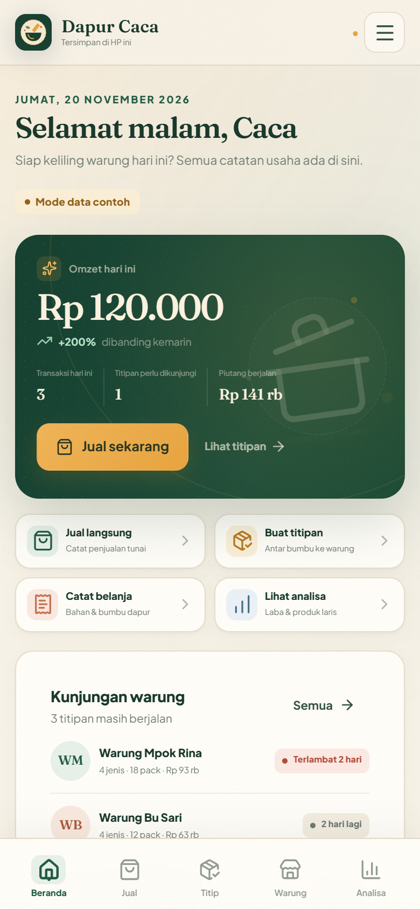
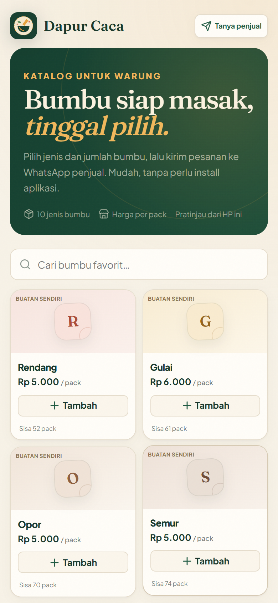
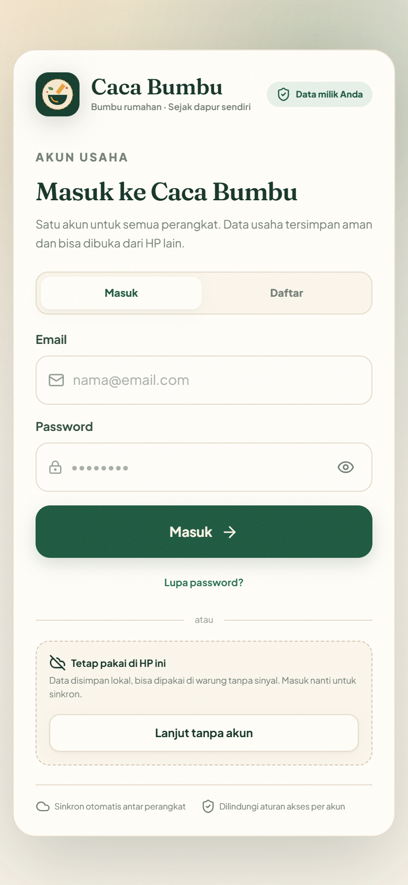

# Caca Bumbu

Aplikasi web **mobile-first / PWA** untuk usaha bumbu rumahan: jual langsung, titipan warung, hitung laku berkala, setoran, stok, dan analisa usaha. Dibuat agar nyaman dipakai satu tangan di HP Android dan tetap bisa dibuka saat sinyal di warung sedang buruk.

Data usaha disimpan di **Supabase** (akun email + password, PostgreSQL dengan RLS) dan tetap tersedia luring di perangkat lewat cache lokal. Deploy produksi memakai **Netlify**.

**Repository:** https://github.com/deamok/caca-bumbu  
**Aplikasi live:** _(isi URL Netlify setelah deploy pertama, mis. https://caca-bumbu.netlify.app)_



| Kasir langsung | Hitung titipan |
| --- | --- |
|  |  |

| Analisa usaha | Katalog warung |
| --- | --- |
|  |  |

Tampilan desktop tersedia di [dashboard](docs/screenshots/dashboard-desktop.png) dan [analisa](docs/screenshots/analysis-desktop.png).

| Masuk ke akun |
| --- |
|  |

## Yang sudah ada

- **Jual langsung / kasir** — pilih bumbu, atur jumlah, bayar tunai, QRIS, transfer, atau bon. Stok langsung berkurang.
- **Titipan warung** — catat bumbu yang diantar, tanggal kunjungan, lalu hitung jumlah laku/rusak/kembali.
- **Kunjungan sekali jalan** — saat menghitung titipan, setoran bisa dicatat sekaligus membuat titipan baru untuk periode berikutnya.
- **Stok & produk** — harga jual, HPP, stok, warna kartu, stok menipis, dan riwayat pergerakan stok.
- **Warung langganan** — kontak, alamat, catatan, titipan aktif, piutang, dan riwayat transaksi per warung.
- **Bahan & belanja** — catat belanja pasar, harga satuan otomatis, kategori, dan bahan terbesar.
- **Analisa** — omzet, tren, sumber omzet (langsung vs titipan), bumbu paling laku, estimasi laba kotor, belanja bahan, dan rekomendasi otomatis.
- **Katalog pesanan** — halaman publik untuk warung memilih bumbu, lalu mengirim pesanan ke WhatsApp penjual. Link bisa dibagikan.
- **PWA / luring** — bisa dipasang ke layar utama Android dan tetap terbuka setelah kunjungan pertama.
- **Akun & sinkronisasi** — satu akun untuk banyak perangkat (HP pemilik + HP cadangan), data otomatis dikirim ke cloud dan tetap bisa dipakai tanpa sinyal.
- **Cadangan data** — unduh/pulihkan file JSON. Berguna untuk arsip atau memindahkan data secara manual.

## Mulai cepat

Butuh Node.js 20.19+ dan pnpm.

```bash
pnpm install
cp .env.example .env   # lalu isi kredensial Supabase
pnpm dev
```

Buka alamat yang ditampilkan Vite. Tanpa kredensial Supabase, aplikasi otomatis berjalan dalam **mode lokal** (seperti versi 1.0) — cocok untuk pengembangan UI tanpa jaringan.

Build produksi:

```bash
pnpm build
pnpm preview
```

Folder hasil build ada di `dist/`.

## Arsitektur data

```text
UI / domain (pure, teruji)          AppState
        │                              │
        │  aksi pengguna               │  localStorage (cache luring)
        ▼                              ▼
  StoreProvider ────────────► cloudSchema (state ↔ baris tabel)
                                   │
                                   ▼
                        SyncProvider (diff + antrean)
                                   │
                                   ▼
                     Supabase Postgres (RLS per akun)
```

- **Sumber kebenaran saat online:** tabel Supabase. Setiap akun hanya bisa membaca/menulis barisnya sendiri (RLS `auth.uid() = user_id`).
- **Saat luring:** semua aksi tetap berjalan di `AppState` lokal dan disimpan ke `localStorage`. Perubahan masuk antrean, lalu dikirim otomatis ketika kembali online.
- **Sinkronisasi:** setiap perubahan dihitung sebagai *diff* baris (upsert/hapus) lalu dikirim per tabel. Setelah terkirim, perangkat menarik data terbaru agar perubahan dari perangkat lain ikut masuk.
- **Konflik:** per baris, perubahan terakhir yang terkirim menang. Untuk kasus data yang tidak cocok, Pengaturan menyediakan **Unggah data HP ini** dan **Ambil dari cloud**.
- **Tanpa kredensial:** seluruh lapisan cloud dimatikan, aplikasi kembali menjadi lokal murni.

Detail tabel, kebijakan RLS, dan alur sinkronisasi ada di [docs/migrasi-supabase.md](docs/migrasi-supabase.md).

## Setup Supabase

1. Buat project di [supabase.com](https://supabase.com) (region terdekat, mis. Singapore).
2. Buka **Project Settings → API**, salin **Project URL** dan **anon public key**.
3. Jalankan skema database — pilih salah satu:
   - **Dashboard → SQL Editor** → tempel isi [supabase/migrations/20261121090000_init.sql](supabase/migrations/20261121090000_init.sql) → **Run**.
   - atau lewat Management API (butuh access token dari [Account → Tokens](https://supabase.com/dashboard/account/tokens)):
     ```bash
     SUPABASE_ACCESS_TOKEN=sbp_xxx SUPABASE_PROJECT_REF=abcdefghijk pnpm db:apply
     ```
     Skrip akan menjalankan semua file di `supabase/migrations/` lalu mencetak daftar tabel yang terbentuk.
4. Pastikan **Authentication → Providers → Email** aktif. Untuk onboarding cepat, **Confirm email** boleh dimatikan; bila dibiarkan aktif, pengguna harus klik tautan konfirmasi sebelum bisa masuk.
5. Isi `.env` lokal:
   ```bash
   VITE_SUPABASE_URL=https://xxxx.supabase.co
   VITE_SUPABASE_ANON_KEY=eyJhbGciOi...
   ```
   `anon key` memang aman dipakai di browser karena akses data dibatasi RLS. **Jangan** pernah memakai `service_role key` di aplikasi web.

Saat pengguna pertama kali masuk, data lokal di perangkat otomatis diunggah ke akun tersebut. Perangkat berikutnya cukup masuk dengan akun yang sama.

## Deploy ke Netlify

Deploy memakai Git (continuous deployment), bukan upload manual.

1. Push repository ke GitHub (branch `main`).
2. Netlify → **Add new site → Import an existing project → GitHub** → pilih repo `caca-bumbu`.
3. Build command `pnpm build`, publish directory `dist`, dan Node 22 sudah diatur oleh [netlify.toml](netlify.toml). Tidak perlu diubah manual.
4. **Site configuration → Environment variables** → tambahkan:
   - `VITE_SUPABASE_URL`
   - `VITE_SUPABASE_ANON_KEY`
5. **Deploy site**. Setiap push ke `main` akan otomatis build ulang.
6. Sesuaikan **Authentication → URL Configuration** di Supabase:
   - **Site URL**: `https://<nama-site>.netlify.app`
   - **Redirect URLs**: `https://<nama-site>.netlify.app/**` (tambahkan juga `http://127.0.0.1:4173/**` untuk pengembangan lokal)
7. (Opsional) Atur custom domain di Netlify, lalu perbarui Site URL dan Redirect URLs di Supabase.

Catatan penting:

- **Service worker dan pemasangan PWA memerlukan HTTPS.** Netlify otomatis memberi HTTPS.
- Tanpa dua environment variable di atas, build Netlify akan berjalan dalam **mode lokal** (tanpa login/cloud). Halaman login hanya muncul bila kredensial terpasang.
- `netlify.toml` sudah mengatur cache: aset ber-hash `immutable`, `sw.js` selalu segar, dan header keamanan dasar.

## Alur kerja yang disarankan

### 1. Awal

Setelah masuk/daftar, pilih **Coba dengan data contoh** untuk melihat semua fitur, atau **Mulai dari nol** untuk usaha sebenarnya.

Jika memulai dari nol:
1. Buka **Produk & stok**.
2. Ketuk tiap bumbu, isi stok awal dan HPP (opsional).
3. Tambahkan warung di menu **Warung**.

Daftar 10 bumbu dan harga awal berasal dari [data/list-bumbu.csv](data/list-bumbu.csv).

### 2. Jual langsung

**Jual** → pilih bumbu → **Bayar** → pilih pembeli dan metode → simpan. Bon otomatis masuk piutang.

### 3. Titip ke warung

**Titip** → **Titip baru** → pilih warung, tanggal kunjungan, dan jumlah pack. Stok langsung berkurang saat titipan dibuat.

### 4. Saat datang lagi ke warung

Buka titipan yang aktif → pada tiap bumbu isi **Laku** dan **Rusak**. Sisa otomatis dianggap kembali ke stok. Isi setoran yang diterima, lalu:

- aktifkan **Langsung titip bumbu baru** jika membawa stok pengganti,
- periksa ringkasan dan konfirmasi.

Satu kunjungan bisa menutup titipan lama, mencatat setoran, mengembalikan stok, dan membuat titipan baru sekaligus. Jika setoran kurang dari total laku, sisa menjadi piutang warung.

### 5. Katalog pesanan

Buka **Pengaturan** → isi **Nomor WhatsApp penjual** → simpan → **Bagikan katalog**. Warung membuka link, memilih bumbu, lalu pesanan diteruskan sebagai pesan WhatsApp ke penjual.

Katalog tidak membuat pesanan di server. Pesanan baru masuk setelah warung menekan kirim di WhatsApp dan penjual mencatatnya sebagai penjualan/titipan.

Link katalog membawa **snapshot** nama usaha, daftar produk, harga, stok, dan nomor WhatsApp pada saat link dibuat. Ini membuat katalog tetap bisa dibuka di HP warung tanpa login. Jika harga/stok berubah, bagikan ulang link katalog yang baru.

## Akun, data, dan privasi

- Data utama tersimpan di **Supabase** pada akun pemilik. Setiap baris tabel memiliki `user_id` dan dilindungi RLS, sehingga akun lain tidak bisa membaca walaupun memegang `anon key`.
- Perangkat menyimpan cache di **localStorage** dengan kunci `caca-bumbu:state:v1`, plus penanda sinkronisasi `caca-bumbu:sync:v1`. Cache ini yang membuat aplikasi tetap jalan di warung tanpa sinyal.
- Perubahan luring dikirim otomatis saat online, saat aplikasi kembali dibuka, atau setiap menit selama aplikasi terlihat. Bisa juga dipicu manual dari **Pengaturan → Sinkronkan sekarang**.
- **Keluar akun** tidak menghapus data di HP; data baru dihapus lewat **Pengaturan → Hapus semua data** (yang juga membersihkan cloud).
- Data contoh memakai nomor telepon fiktif dan nomor WhatsApp kosong. Isi nomor asli sebelum membagikan katalog.
- Unduh backup (JSON) secara berkala bila ingin arsip mandiri.

## Teknologi

- React 19 + TypeScript + Vite 6
- Supabase (Auth email/password, PostgreSQL, RLS) — klien dimuat *lazy*, hanya bila kredensial ada
- Lucide React untuk ikon
- Font lokal Plus Jakarta Sans & Fraunces (tanpa CDN)
- CSS responsif buatan sendiri, mobile-first
- Manifest + service worker buatan sendiri (offline-first)
- Vitest untuk logika domain dan pemetaan data cloud
- Playwright untuk uji alur, PWA, dan tangkapan layar
- Netlify untuk hosting statis

## Struktur proyek

```text
src/
  components/      komponen UI, shell navigasi, badge sinkron, kartu, sheet, chart
  data/seed.ts     produk awal + data contoh
  lib/
    domain.ts      logika bisnis (murni, teruji)
    analytics.ts   analisa usaha
    storage.ts     cache localStorage, backup/restore
    cloudSchema.ts pemetaan AppState ↔ baris Supabase, diff, merge
    cloudSync.ts   baca/tulis tabel Supabase
    supabase.ts    klien Supabase (lazy) + flag konfigurasi
  pages/           semua layar aplikasi (termasuk AuthPage)
  store/
    StoreContext.tsx  state usaha + persistensi lokal
    AuthContext.tsx   sesi login Supabase
    SyncContext.tsx   antrean sinkronisasi, status, konflik
  styles*.css      design system dan CSS per area
supabase/
  migrations/      skema tabel, RLS, index
public/
  icons/           ikon PWA
  manifest.webmanifest
  sw.js
data/
  list-bumbu.csv   sumber daftar bumbu awal
scripts/
  apply-supabase.mjs  terapkan migrasi via Management API
  e2e.mjs             uji alur utama (butuh preview server)
  e2e-clean.mjs       uji mulai dari nol
  e2e-payment.mjs     uji pelunasan piutang
  pwa-check.mjs       uji manifest, ikon, service worker, offline
  live-check.mjs      uji aplikasi live (isi URL Netlify)
```

Logika bisnis ada di [src/lib/domain.ts](src/lib/domain.ts), analisa di [src/lib/analytics.ts](src/lib/analytics.ts), pemetaan database di [src/lib/cloudSchema.ts](src/lib/cloudSchema.ts).

## Pengujian

```bash
pnpm test
```

Untuk uji end-to-end, jalankan preview di terminal lain:

```bash
pnpm build
pnpm preview
node scripts/e2e.mjs
node scripts/e2e-clean.mjs
node scripts/e2e-payment.mjs
node scripts/pwa-check.mjs
```

Uji aplikasi live memakai `BASE` dari environment:

```bash
APP_URL=https://caca-bumbu.netlify.app node scripts/live-check.mjs
```

Uji alur cloud (login, unggah awal, diff, antrean luring, perangkat kedua, hapus data) memakai **Supabase tiruan** di dalam Playwright — tidak butuh akun atau jaringan:

```bash
VITE_SUPABASE_URL=https://demo-project.supabase.co VITE_SUPABASE_ANON_KEY=demo \
  pnpm exec vite build --outDir dist-auth
pnpm exec vite preview --outDir dist-auth --port 4180   # terminal lain
pnpm test:cloud
```

`pnpm test:cloud` menjalankan [scripts/cloud-e2e.mjs](scripts/cloud-e2e.mjs) terhadap server di `http://127.0.0.1:4180/` (bisa diubah lewat `CLOUD_BASE`).

## Batasan versi ini

- Sinkronisasi bersifat **last-write-wins per baris**. Bila dua perangkat mengubah data yang sama persis dalam waktu bersamaan, perubahan yang terakhir terkirim yang tersimpan.
- Satu akun untuk satu usaha. Belum ada peran kasir/pegawai, log audit, atau persetujuan perubahan.
- Pesanan katalog dikirim lewat WhatsApp, bukan pesanan otomatis di server.
- Pembelian bahan adalah catatan pengeluaran; belum ada resep produksi, stok bahan mentah, atau konversi otomatis bahan → pack bumbu.
- HPP harus diisi manual per produk agar estimasi laba akurat.
- Belum ada integrasi pembayaran/QRIS otomatis atau printer struk.

Pengembangan berikutnya yang paling masuk akal: pesanan katalog langsung masuk dashboard, akun kasir dengan hak akses terbatas, dan rekap lintas perangkat berbasis SQL.
