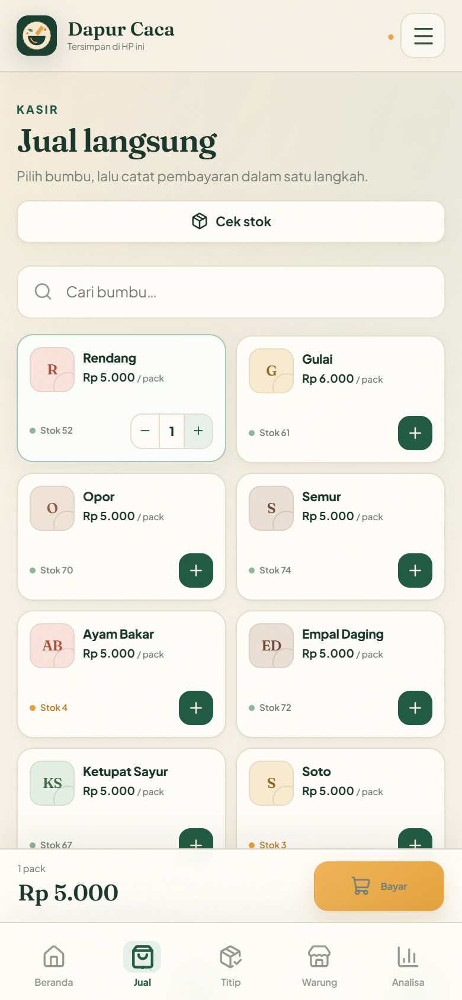
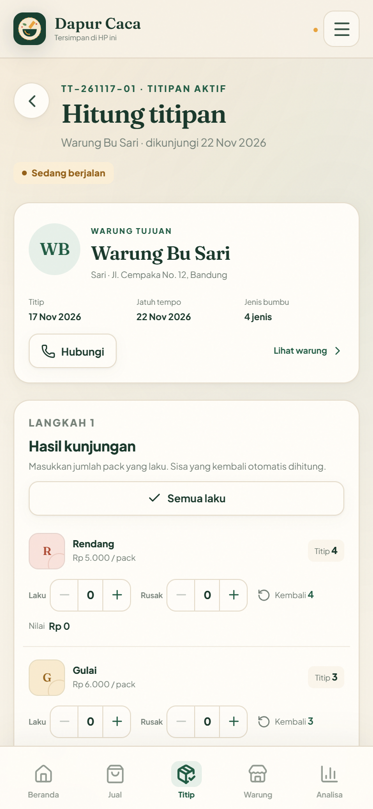
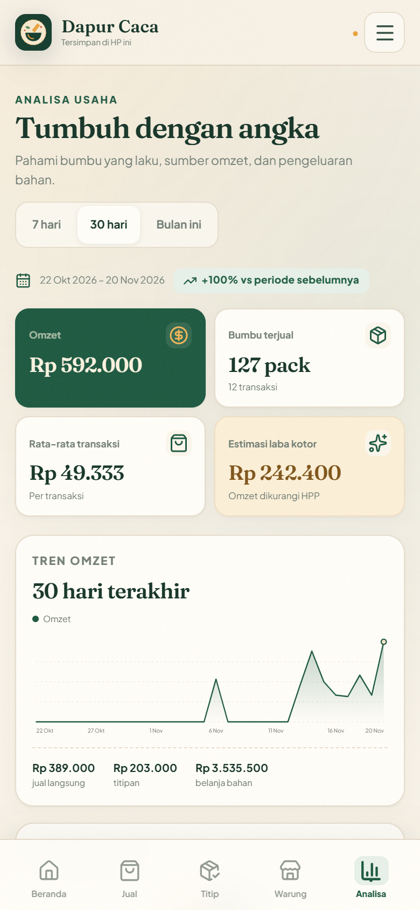

# Caca Bumbu

Aplikasi web **mobile-first / PWA** untuk usaha bumbu rumahan: jual langsung, titipan warung, hitung laku berkala, setoran, stok, dan analisa usaha. Dibuat agar nyaman dipakai satu tangan di HP Android dan tetap bisa dibuka saat sinyal di warung sedang buruk.


| Kasir langsung | Hitung titipan |
| --- | --- |
|  |  |

| Analisa usaha | Katalog warung |
| --- | --- |
|  |  |

Tampilan desktop tersedia di [dashboard](docs/screenshots/dashboard-desktop.png) dan [analisa](docs/screenshots/analysis-desktop.png).

## Yang sudah ada

- **Jual langsung / kasir** — pilih bumbu, atur jumlah, bayar tunai, QRIS, transfer, atau bon. Stok langsung berkurang.
- **Titipan warung** — catat bumbu yang diantar, tanggal kunjungan, lalu hitung jumlah laku/rusak/kembali.
- **Kunjungan sekali jalan** — saat menghitung titipan, setoran bisa dicatat sekaligus membuat titipan baru untuk periode berikutnya.
- **Stok & produk** — harga jual, HPP, stok, warna kartu, stok menipis, dan riwayat pergerakan stok.
- **Warung langganan** — kontak, alamat, catatan, titipan aktif, piutang, dan riwayat transaksi per warung.
- **Bahan & belanja** — catat belanja pasar, harga satuan otomatis, kategori, dan bahan terbesar.
- **Analisa** — omzet, tren, sumber omzet (langsung vs titipan), bumbu paling laku, estimasi laba kotor, belanja bahan, dan rekomendasi otomatis.
- **Katalog pesanan** — halaman publik untuk warung memilih bumbu, lalu mengirim pesanan ke WhatsApp penjual. Link bisa dibagikan.
- **PWA / luring** — bisa dipasang ke layar utama Android dan tetap terbuka setelah kunjungan pertama.
- **Cadangan data** — unduh/pulihkan file JSON. Semua data disimpan lokal di HP; tidak ada akun atau server.

## Mulai cepat

Butuh Node.js 20+ dan pnpm.

```bash
pnpm install
pnpm dev
```

Buka alamat yang ditampilkan Vite. Untuk mencoba di HP dalam satu jaringan:

```bash
pnpm dev --host 0.0.0.0
```

Build produksi:

```bash
pnpm build
pnpm preview
```

Folder hasil build ada di `dist/`. Unggah ke hosting statis apa pun (Vercel, Netlify, Cloudflare Pages, GitHub Pages, cPanel). **Service worker dan pemasangan PWA memerlukan HTTPS** (atau localhost saat pengembangan).

### Memasang di Android

1. Buka URL aplikasi di Chrome.
2. Ketuk menu ⋮ → **Tambahkan ke layar utama** / **Instal aplikasi**.
3. Aplikasi akan terbuka tanpa address bar dan tetap bisa dipakai luring setelah aset pertama kali dimuat.

## Alur kerja yang disarankan

### 1. Awal
Pilih **Coba dengan data contoh** untuk melihat semua fitur dengan transaksi contoh, atau **Mulai dari nol** untuk usaha sebenarnya.

Jika memulai dari nol:
1. Buka **Produk & stok**.
2. Ketuk tiap bumbu, isi stok awal dan HPP (opsional).
3. Tambahkan warung di menu **Warung**.

Daftar 10 bumbu dan harga awal berasal dari [data/list-bumbu.csv](data/list-bumbu.csv).

### 2. Jual langsung
**Jual** → pilih bumbu → **Bayar** → pilih pembeli dan metode → simpan. Bon otomatis masuk piutang.

### 3. Titip ke warung
**Titip** → **Titip baru** → pilih warung, tanggal kunjungan, dan jumlah pack. Stok langsung berkurang saat titipan dibuat.

### 4. Saat datang lagi ke warung
Buka titipan yang aktif → pada tiap bumbu isi **Laku** dan **Rusak**. Sisa otomatis dianggap kembali ke stok. Isi setoran yang diterima, lalu:

- aktifkan **Langsung titip bumbu baru** jika membawa stok pengganti,
- periksa ringkasan dan konfirmasi.

Satu kunjungan bisa menutup titipan lama, mencatat setoran, mengembalikan stok, dan membuat titipan baru sekaligus. Jika setoran kurang dari total laku, sisa menjadi piutang warung.

### 5. Katalog pesanan
Buka **Pengaturan** → isi **Nomor WhatsApp penjual** → simpan → **Bagikan katalog**. Warung membuka link, memilih bumbu, lalu pesanan diteruskan sebagai pesan WhatsApp ke penjual.

Katalog tidak membuat pesanan di server. Pesanan baru masuk setelah warung menekan kirim di WhatsApp dan penjual mencatatnya sebagai penjualan/titipan.

## Data, privasi, dan cadangan

- Data disimpan di **localStorage** perangkat dengan kunci `caca-bumbu:state:v1`.
- Tidak ada login, cloud, atau pengiriman data ke pihak ketiga.
- Data tidak otomatis tersinkron antar HP. Gunakan **Pengaturan → Unduh backup** secara rutin.
- Menghapus data browser atau memilih **Hapus semua data** akan menghapus data di perangkat.
- Data contoh menggunakan nomor telepon fiktif dan nomor WhatsApp kosong. Isi nomor asli sebelum membagikan katalog.

## Teknologi

- React 19 + TypeScript + Vite 6
- Lucide React untuk ikon
- Font lokal Plus Jakarta Sans & Fraunces (tanpa CDN)
- CSS responsif buatan sendiri, mobile-first
- Manifest + service worker buatan sendiri (offline-first)
- Vitest untuk logika domain
- Playwright untuk uji alur dan tangkapan layar

## Struktur proyek

```text
src/
  components/      komponen UI, shell navigasi, kartu, sheet, chart
  data/seed.ts     produk awal + data contoh
  lib/             domain, analisa, tanggal, format, storage, router
  pages/           semua layar aplikasi
  store/           provider state + persistensi
  styles*.css      design system dan CSS per area
public/
  icons/           ikon PWA
  manifest.webmanifest
  sw.js
data/
  list-bumbu.csv   sumber daftar bumbu awal
scripts/
  e2e.mjs          uji alur utama (butuh preview server)
  e2e-clean.mjs    uji mulai dari nol
  pwa-check.mjs    uji manifest, ikon, service worker, offline
```

Logika bisnis ada di [src/lib/domain.ts](src/lib/domain.ts), analisa di [src/lib/analytics.ts](src/lib/analytics.ts). Semua operasi stok, titipan, pembayaran, dan pembelian diuji lewat Vitest.

## Pengujian

```bash
pnpm test
```

Untuk uji end-to-end, jalankan preview di terminal lain:

```bash
pnpm build
pnpm preview
node scripts/e2e.mjs
node scripts/e2e-clean.mjs
node scripts/e2e-payment.mjs
node scripts/pwa-check.mjs
```

## Batasan versi ini

- Satu perangkat, satu pengguna. Belum ada akun, multi-perangkat, atau sinkronisasi real-time.
- Pesanan katalog dikirim lewat WhatsApp, bukan pesanan otomatis di server.
- Pembelian bahan adalah catatan pengeluaran; belum ada resep produksi, stok bahan mentah, atau konversi otomatis bahan → pack bumbu.
- HPP harus diisi manual per produk agar estimasi laba akurat.
- Belum ada integrasi pembayaran/QRIS otomatis atau printer struk.

Pengembangan berikutnya yang paling masuk akal: backend Supabase untuk sinkronisasi multi-perangkat, akun kasir, dan pesanan katalog yang langsung masuk ke dashboard.